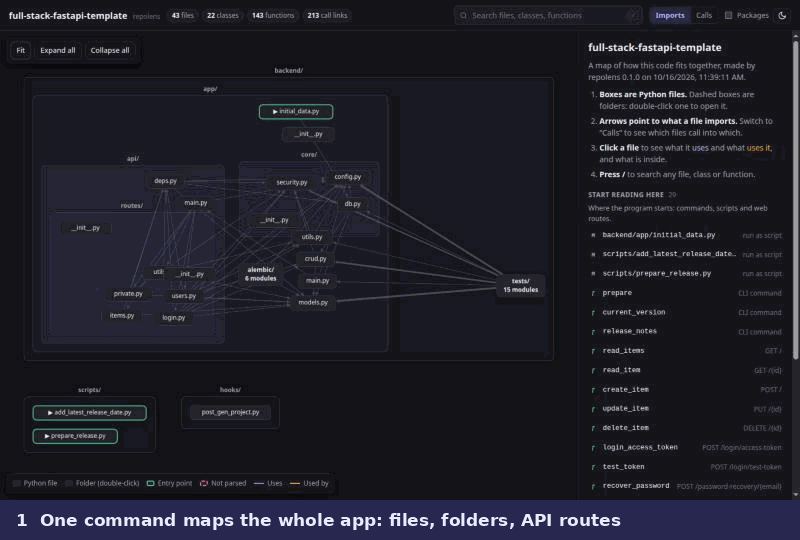

# repolens

**See how your codebase fits together.** repolens turns any Python project into an
interactive map: what every file uses, what uses it, and what breaks if you change it.
It runs offline, produces one HTML file, and needs no AI.

[](https://github.com/Burnaviour/repolens/actions/workflows/ci.yml)
[](pyproject.toml)
[](LICENSE)




<sub>Shown above: <a href="https://github.com/fastapi/full-stack-fastapi-template">fastapi/full-stack-fastapi-template</a>.</sub>

## Why

An AI agent wrote most of your code. It works, but you have never read most of it, and
now you need to change something. Which file does what? What calls this function? What
breaks if you touch it?

repolens answers those questions in seconds, and your code never leaves your machine.

## Try it

You need [uv](https://docs.astral.sh/uv/getting-started/installation/). Then, inside
any Python project:

```bash
uvx --from git+https://github.com/Burnaviour/repolens repolens build . --open
```

This writes `.repolens/report.html` and opens it in your browser. The `.repolens/`
folder ignores itself, so it is never committed by accident.

## What you get

- **A map of the whole project.** Files are boxes inside their folders, and arrows show
  imports. Switch to **Calls** to see which files call into which; thicker arrows mean
  more calls. Large projects start with folders closed (double-click to open one), and
  tests, docs and migrations stay closed so you see the application first.
- **Click a file** to see what it uses (indigo), what uses it (amber), its docstring,
  and the classes and functions inside it.
- **Click a function** to see what it calls and what calls it. Each link says how it
  was found: *resolved* from names and imports, *inferred* from type hints, or
  *guessed* from a unique method name.
- **"Start reading here"** lists where the program starts: commands, scripts, and web
  routes with their method and path (`POST /login/access-token`).
- **Search** every file, class and function with <kbd>/</kbd>, and **read the source**
  next to the map.
- **Big projects work too.** pandas (1,411 files) scans in under 8 seconds, and its
  report opens in under one.

## Private by design

- repolens **reads** your code; it never runs it.
- Nothing is uploaded. The report is one self-contained file that makes no network
  requests, so you can open it offline or send it to a teammate.
- `--no-source` leaves your source code out of the report, keeping only its structure.

## Options

| Option | Meaning |
|---|---|
| `--open` | Open the report in your browser |
| `-o FILE` | Write the report somewhere else, leaving the project untouched |
| `-e PATTERN` | Skip extra paths, gitignore style (`-e "scripts/"`). `.gitignore` is always honoured |
| `--source / --no-source` | Include the source code in the report. By default it is included when the project has under 8 MB of Python |
| `-q` | No progress bar or summary |

`repolens scan .` writes only the data, `graph.json`: every file, class and function
plus the imports, calls, inheritance and decorators between them. Its format is
documented in [docs/graph-schema.md](docs/graph-schema.md), so you can build your own
tools on it.

## Roadmap

- [x] Code graph for Python, with call links that say how sure they are
- [x] Interactive offline map with search and source view
- [ ] **Flow view:** follow a command or web request step by step through the code
- [ ] **Framework wiring:** FastAPI `Depends`, callbacks and overridden methods as links
- [ ] **Plain-English explanations** of files, folders and flows from a local model
      (Ollama), optional
- [ ] JavaScript and TypeScript

## Contributing

Bug reports and ideas are welcome: please [open an issue](https://github.com/Burnaviour/repolens/issues).
To work on the code, see [CONTRIBUTING.md](CONTRIBUTING.md) and
[how repolens works](docs/architecture.md).

If repolens helps you, a ⭐ helps other people find it.

## License

[MIT](LICENSE). Reports bundle [Preact](https://preactjs.com) (MIT),
[htm](https://github.com/developit/htm) (Apache-2.0),
[Cytoscape.js](https://js.cytoscape.org) and
[cytoscape-fcose](https://github.com/iVis-at-Bilkent/cytoscape.js-fcose) (MIT); see
[their licenses](src/repolens/render/static/vendor/licenses).
