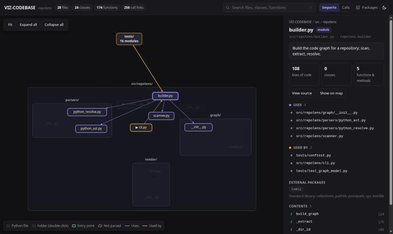

# repolens

**See how your (vibe-coded) codebase fits together: offline, interactive, AI optional.**

[](https://github.com/Burnaviour/repolens/actions/workflows/ci.yml)
[](LICENSE)

When agents write your code, you end up shipping code you have never read. `repolens`
gives you back the mental map. Point it at a repository and it produces an interactive
page that shows which files depend on which, what every file, class and function does,
how calls flow, and where the risky parts are.



> **Status: early development (pre-alpha).** The code graph and the interactive map
> work today, with no AI. Metrics, a call graph explorer and AI summaries come next.
> See the [roadmap](#roadmap).

## Try it

```bash
uvx --from git+https://github.com/Burnaviour/repolens repolens build ./my-project --open
```

This writes `./my-project/.repolens/report.html` and opens it. It is **one file that
works offline**: there are no CDN calls, nothing is uploaded, and you can open it from
disk, send it to someone or host it on GitHub Pages. The `.repolens/` folder ignores
itself, so it is never committed by accident.

In the report:

- **Boxes are Python files and dashed boxes are folders.** Double-click a folder to open
  it. Big projects start with folders closed, and test folders stay closed so the first
  view shows the application code.
- **Arrows point to what a file imports.** Switch to **Calls** to see which files call
  into which; thicker arrows mean more calls. **Packages** adds the third-party
  libraries.
- **Click a file** to see what it uses (indigo), what uses it (amber), its docstring,
  and every class and function inside it.
- **Click a function** to see what it calls and what calls it, each link labelled
  *resolved*, *inferred* or *guessed*, then **View source** to read it.
- **Press `/`** to search every file, class and function.
- **"Start reading here"** lists the entry points: `__main__` blocks, console scripts,
  and CLI and HTTP handlers.

| Option | Meaning |
|---|---|
| `--open` | Open the report in your browser |
| `-o FILE` | Write the report somewhere else (and leave the repository untouched) |
| `-e PATTERN` | Skip extra paths, gitignore style (`-e tests/ -e "*_pb2.py"`). `.gitignore` files are always honoured |
| `--source / --no-source` | Embed the source code so the report can show it. By default only when the project has under 8 MB of Python |
| `-q` | No progress bar or summary |

### Just the data

`repolens scan ./my-project` writes only `graph.json`: every directory, file, module,
class and function plus the imports, calls, inheritance and decorators between them.
Use `-o -` to print it to stdout. The format is documented in
[docs/graph-schema.md](docs/graph-schema.md).

### How big can a project be?

Scanning is fast. On a laptop, Flask (24 files) takes 0.3 s, SQLAlchemy (255 files)
1.8 s and pandas (1,411 files) 7.6 s. The pandas report opens in under a second.

## Planned features

- **Insight.** A call graph explorer, a treemap, and a health view (hotspots, import
  cycles, dead code).
- **Local AI (optional).** Summaries from Ollama, LM Studio or llama.cpp, so your code
  never leaves your machine.
- **Cloud and agentic AI (optional, opt-in).** Claude or any OpenAI-compatible API for
  deeper explanations, guided tours and "ask your codebase" Q&A.
- **Architecture diff.** See what an agent's branch changed *structurally*: new files,
  new dependencies, new cycles.

```bash
# planned: local AI through Ollama
uvx repolens build ./my-project --ai ollama --model qwen2.5-coder:7b
```

## Roadmap

| Milestone | Deliverable | Status |
|---|---|---|
| M0 Setup | uv project, CI, license | ✅ |
| M1 Graph | Scanner + Python parser + `graph.json` | ✅ |
| M2 Viewer | Offline `report.html`: architecture map, file inspector, search, source view | ✅ |
| M3 Insight | Call graph explorer, metrics, hotspots, cycles, treemap, `ARCHITECTURE.md` | ⏳ next |
| M4 Local AI | Ollama summaries: bottom-up, cached | |
| M5 Cloud + Agent | Claude / OpenAI-compatible, guided tour, `serve` + Ask box | |
| M6 Extras | `diff` mode, JS/TS support, framework plugins, MCP server, GitHub Action | |

The full design is in [docs/PROPOSAL.md](docs/PROPOSAL.md).

## Development

You need [uv](https://docs.astral.sh/uv/). The viewer is plain JavaScript with no build
step, so you do not need Node.

```bash
git clone https://github.com/Burnaviour/repolens.git
cd repolens
uv sync
uv run repolens build . --open    # map repolens itself
uv run pytest
uv run ruff check . && uv run ruff format --check .
```

| Path | What lives there |
|---|---|
| `src/repolens/scanner.py` | Finds files, honours `.gitignore` |
| `src/repolens/parsers/` | Python extraction (`python_ast.py`) and cross-file linking (`python_resolve.py`) |
| `src/repolens/graph/` | The graph model and `graph.json` format |
| `src/repolens/render/` | Builds `report.html`; the viewer is in `static/app.js` and `static/app.css` |

## License

[MIT](LICENSE). The report bundles [Preact](https://preactjs.com) (MIT),
[htm](https://github.com/developit/htm) (Apache-2.0),
[Cytoscape.js](https://js.cytoscape.org) and
[cytoscape-fcose](https://github.com/iVis-at-Bilkent/cytoscape.js-fcose) (MIT);
see [their licenses](src/repolens/render/static/vendor/licenses).
